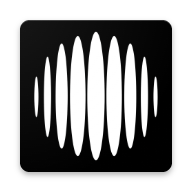

<div align="center">
  
  <h1>Flambo 2.0</h1>
  <p><em>A calm yet expressive voice recorder for Android — record, transcribe, and keep everything on your device.</em></p>
  <p></p>
  <p>
    <a href="https://m3.material.io/blog/introducing-m3-expressive"></a>
    <a href="https://kotlinlang.org"></a>
    <a href="https://developer.android.com/jetpack/compose"></a>
    
    
    <a href="https://github.com/MoHamed-B-M/flambo/releases"></a>
  </p>
  <p>
    <a href="https://github.com/MoHamed-B-M/flambo/actions/workflows/build.yaml"></a>
    
    
    <a href="https://github.com/MoHamed-B-M/flambo/blob/2.0/CONTRIBUTING.md"></a>
  </p>
</div>

## What's new in 2.0

Our biggest update yet: Flambo is redesigned from the ground up in Material 3 Expressive, with a rebuilt recording pipeline, a faster, smoother feel, and the features people asked for most. Your audio still stays on your device.

- **Rebuilt core** — one recording and playback pipeline for a smoother, more reliable app.
- **Chunked recording + auto-backup** — long takes rotate through staged chunks at a configurable interval, and an interrupted session can be recovered on the next launch.
- **Call-aware pause** — an incoming call or audio focus loss pauses the active take instead of ruining it.
- **Bookmarks** — mark a moment while recording or during playback, then jump straight to it on the waveform.
- **Speech model manager** — choose a Whisper language model or import your own, all offline.
- **2.0 welcome sheet** — a one-time Material 3 expressive introduction to the redesign, replayable from Settings.

## Features

- **One-tap recording** with an animated-shape record button, live waveform, pause/resume on a continuous timeline, and bookmarks
- **Two sources** — microphone, or system sound (music, videos, app audio) via AudioPlaybackCapture on Android 10+
- **Live notification** with running timer plus Pause/Resume and Save actions, so recording survives the screen turning off
- **Offline transcription** — Whisper turns saved recordings into text on-device; downloadable or imported language models, copy/share/edit, transcripts are searchable
- **Noise reduction** — live AGC and noise suppression while recording (toggle in Settings)
- **Clean audio** — one-tap offline enhancement (hush + leveling) with Light/Balanced/Strong strength, keep or replace the original
- **Playback** with waveform scrubber, 0.5x–2x speed pills, 5 s / 10 s skips, bookmarks, and a floating mini-player
- **Library** — inline rename, tags, favorites, sort/filter, full-text search, soft delete with Undo, auto-purging Trash, custom storage folder and recording name prefix
- **Onboarding tour** on first launch, replayable anytime from Settings → About
- **Shortcuts & automation** — long-press the launcher icon for Start / Pause, or fire recording actions from Key Mapper, Tasker, and other automation apps entirely headlessly
- **Self-updates** — Settings checks stable releases and installs them in-app with auto-cleanup
- **Material 3 Expressive throughout** — dynamic Material You color, tonal surfaces instead of shadows, morphing shapes, bouncy spring motion, edge-to-edge layout

## Screenshots

<p align="center">
  
</p>

## Get the app

[](https://rookieenough.github.io/Orion-Data/redirect.html?id=flambo)
<a href="https://komistore.app/app/?repo=MoHamed-B-M/flambo"></a>

**Flambo 2.0 previews** are attached to successful runs of the [`2.0` build workflow](https://github.com/MoHamed-B-M/flambo/actions/workflows/build.yaml): open a run, download the `Flambo-2.0-dev<N>` artifact, unzip it, and install the APK. Builds are named `2.0.0-dev(#N)` and kept for 14 days.

The release APK is universal — it bundles `arm64-v8a`, `armeabi-v7a`, and `x86_64` libraries, so there is one file for every device.

> [!NOTE]
> Enable *Install unknown apps* for your browser when sideloading. 2.0 preview artifacts are signed with the project keystore when CI secrets are configured; otherwise an ephemeral preview keystore is used, so you may need to uninstall an older preview before installing a new one.

## Build it yourself

```bash
git clone --recurse-submodules https://github.com/MoHamed-B-M/flambo.git
cd flambo
git checkout 2.0              # active development happens here
./gradlew :app:assembleRelease
```

The recursive clone is needed for the pinned `whisper.cpp` submodule. A debug-keystore fallback means `assembleRelease` works locally with no secrets configured. The universal APK lands in `app/build/outputs/apk/release/`.

Requirements: **JDK 21**, **AGP 8.12.3**, **Kotlin 2.2.21**, **Compose BOM 2025.10.01**, Android SDK `minSdk 24 / targetSdk 36`, NDK `27.0.12077973`, and CMake `3.22.1`.

## How CI works

[`build.yaml`](.github/workflows/build.yaml) builds every push and pull request to `2.0`:

- Produces a signed `2.0.0-dev(#N)` APK with version code `200000 + N` and uploads it as an artifact (14-day retention).
- Runs unit tests and lint, uploading both reports as artifacts.
- Uses the project keystore from secrets when available; otherwise generates an ephemeral preview keystore.
- Does **not** publish GitHub Releases for 2.0 previews — builds come from the workflow run.

### Required secrets

| Secret | Purpose |
|---|---|
| `KEYSTORE_BASE64` | Release keystore, base64-encoded |
| `KEYSTORE_PASSWORD` | Keystore password |
| `KEY_ALIAS` | Key alias |
| `KEY_PASSWORD` | Key password |

## Versioning

This app follows a modified **Semantic Versioning**: `MAJOR.MINOR.PATCH+BUILD`

| Number | Meaning | When to increase |
|---|---|---|
| MAJOR | Big update | Breaking changes, redesigns, major architecture |
| MINOR | New feature | Adding features without breaking existing ones |
| PATCH | Fix / small update | Bug fixes, tweaks, performance improvements |
| BUILD | Build number | Every new build/compile (always increments) |

Format examples:

- `1.0.0+1` → first stable release, first build
- `1.7.4+14` → the last release before the redesign
- `2.0.0+120` → complete UI redesign + rebuilt audio pipeline
- `2.0.1+121` → rebuilt with updated libraries

2.0 preview builds follow the release line with a dev tag: `2.0.0-dev(#N)`, where `N` is the CI run number (e.g. `2.0.0-dev(#42)`). Their version code is `200000 + N`, so a preview always installs over an earlier release as an update.

## Project structure

```
app/src/main/java/com/pranshulgg/recordmaster/
├── core/
│   ├── record/          # RecordingController, foreground service, chunk rotation, shortcuts, receiver
│   ├── audio/           # Offline enhancer, chunk merger
│   ├── stt/             # Whisper engine, model manager/store, transcription service
│   ├── playback/        # PlaybackController, service, review controller
│   ├── data/            # Room database, repository, DataStore preferences, SAF folder helpers
│   └── domain/          # Quality, auto-save interval, sort/filter enums
├── ui/
│   ├── components/      # Waveform, cards, segmented list, mini-player, 2.0 welcome sheet
│   ├── expressive/      # Shared expressive buttons and motion
│   └── theme/           # M3 Expressive color / type / shape / motion tokens
├── screens/             # Home, recording, playback, settings, about, onboarding
├── helpers/             # Legacy appearance preferences
└── RecordMasterApp.kt   # Composition root for the 2.0 logic layer
```

MVVM throughout: `ViewModel` + `StateFlow` UI state, repository pattern, thin platform wrappers.

## Permissions

| Permission | Why |
|---|---|
| `RECORD_AUDIO` | Microphone recording — also required by Android for system-sound capture (prompted at first launch and when needed) |
| System-capture consent | One-time system dialog for system-sound recording, like a screen recorder |
| `FOREGROUND_SERVICE_*` | Keeps recording alive with the screen off (mic / playback / projection types, narrowed per take) |
| `POST_NOTIFICATIONS` | Recording timer + update-ready notifications (Android 13+) |
| `INTERNET` | Only for offline speech-model downloads and the update checker — audio never leaves the device |

> [!IMPORTANT]
> When enabling system-sound capture, Android shows a *screen-recording* consent dialog. Flambo only captures audio — no pixels are ever read (the codebase contains no virtual display; the MediaProjection token feeds `AudioPlaybackCaptureConfiguration` exclusively).

## Shortcuts & automation

Recording is reachable without opening the app:

- **Launcher shortcuts** — long-press the Flambo icon for **Start recording** and **Pause / Resume**.
- **Key Mapper / Tasker** — pick Flambo from an automation app's "launch app shortcut" list and choose one of five discrete actions: **Record**, **Pause**, **Stop**, **Toggle record/pause**, or **Toggle record/stop**. They run headlessly — no activity is foregrounded, even from the lock screen.
- **Broadcasts** — apps that send intents can target the exported `RecordingReceiver` with `com.flambo.recorder.ACTION_START`, `com.flambo.recorder.ACTION_STOP`, or `com.flambo.recorder.ACTION_TOGGLE`.

## Tech stack

Kotlin 2.2.21 · Compose (BOM 2025.10.01) · Material3 1.4.0 · Navigation Compose · Room 2.8.5 (KSP) · DataStore · Media3 ExoPlayer · whisper.cpp 1.9.5 · AGP 8.12.3 · JDK 21. minSdk 24, targetSdk 36.

---

## 📈 Commits

<p align="center">
  <a href="https://github.com/MoHamed-B-M/flambo/graphs/commit-activity">
    
  </a>
</p>

<p align="center">
  <sub>Daily contributions · <a href="https://github.com/MoHamed-B-M/flambo/graphs/commit-activity">commit activity</a> · <a href="https://github.com/MoHamed-B-M/flambo/pulse">pulse</a></sub>
</p>

<div align="center">
  
  
</div>

## ⭐ Star History

<a href="https://www.star-history.com/?repos=mohamed-b-m%2Fflambo&type=date&legend=top-left">
  <picture>
    <source media="(prefers-color-scheme: dark)" srcset="https://api.star-history.com/chart?repos=mohamed-b-m/flambo&type=date&theme=dark&legend=top-left" />
    <source media="(prefers-color-scheme: light)" srcset="https://api.star-history.com/chart?repos=mohamed-b-m/flambo&type=date&legend=top-left" />
    
  </picture>
</a>
